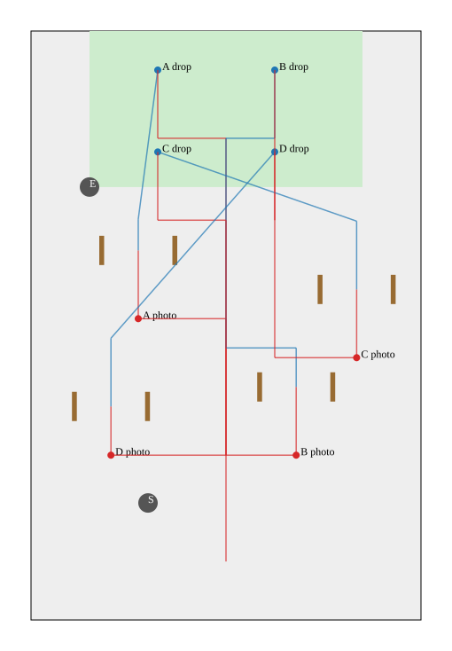

# 固定路线仿真：ABCD拍照与搬运

2026-11-21。使用已有Gazebo场地和CAD小车，先验证完整状态机和固定路线，再用实测参数调整。机器人与货架通过 `set_pose` 更新，举升后货架随车移动，放下后留在目的区；没有轮胎打滑、碰撞响应、托叉接触或载荷动力学。真实建图定位、机构标定与实车取放仍按[原方案](建图定位与固定路线方案.md)独立验收。

## 构建与运行

在仓库根目录打开zsh：

```zsh
source /opt/ros/jazzy/setup.zsh
cd ros2_ws
colcon build --symlink-install --packages-up-to sim_control
source install/setup.zsh
export ROS_DOMAIN_ID=77
export ROS_LOG_DIR=/tmp/fixed_route_roslogs
export GZ_PARTITION=dase7503_fixed_route
ros2 launch sim_control fixed_route_sim.launch.py
```

bash改用对应 `setup.bash`。仿真使用独立domain77，避免向domain42上的真实底盘发送指令。启动打开Gazebo/RViz并关闭手动速度面板，先零速待命；不要同时开teleop、旧waypoint_driver或Nav2控制器。

此launch默认也会将子进程的ROS domain设为77；如需另选仿真domain，用 `ros_domain_id:=78`并同步修改其他操作终端的环境变量。

第二个终端也从 `ros2_ws/` 加载ROS环境和工作区，设置相同的 `ROS_DOMAIN_ID=77` 和 `ROS_LOG_DIR`，然后：

```zsh
ros2 service call /mission/start std_srvs/srv/Trigger '{}'
ros2 topic echo /mission/status std_msgs/msg/String
# 取消：零速锁存，保留载荷支撑
ros2 service call /mission/cancel std_srvs/srv/Trigger '{}'
# 已结束/已取消后，恢复全部货架和机器人出生位姿
ros2 service call /mission/reset std_srvs/srv/Trigger '{}'
```

开始前检查出生位姿与停稳、相机/odom/scan新鲜度、仿真货架就绪、唯一速度发布者；拒绝启动会返回具体原因。复位服务成功表示“已接受”，等待status中 `reset_pending=false`、`state=IDLE`后再start。失败时查看reason；Gazebo服务失效则重启整个仿真。Ctrl+C停止launch。

可选启动参数：

```zsh
# 关闭窗口，仍需可用的传感器图形渲染环境
ros2 launch sim_control fixed_route_sim.launch.py gui:=false rviz:=false
# 就绪后自动开始一次；复位后不会再次自动开始
ros2 launch sim_control fixed_route_sim.launch.py autostart:=true
# 载入自己的校准副本，指定证据目录
ros2 launch sim_control fixed_route_sim.launch.py \
  config:=/absolute/path/my_route.yaml output_dir:=/absolute/path/run_evidence
```

## 每架执行顺序

默认A→B→C→D，每架依次：

1. `TO_PHOTO`：沿固定折点到 `photo_pose`，转到指定朝向并停稳。
2. `DWELL → PHOTO`：等待稳定后保存一张到位后新曝光的相机PNG，不等待QR解码。无新图或保存失败则停车。
3. `ENTER`：沿车头前进 `enter_distance_m` 到可举升位置并停稳。
4. `LIFT → LIFT_WAIT`：发 `/lifter=1`；仿真适配器检查对齐/停稳并确认Gazebo已抬起货架，再等待稳定。
5. `CLEAR_RACK → TO_DROP`：按 `clear_direction` 离架 `clear_distance_m`，再沿预写折点送到专属 `drop_pose`。当前四架均为 `forward`：举升后继续向+Y前进，不再退回拍照位。
6. `LOWER → LOWER_WAIT`：停稳，发 `/lifter=0`，确认放下并等待稳定。
7. `EXIT`：沿当前朝向后退 `exit_distance_m`，再去下一架。D退出后DONE、持续零速。

直行和转向分开，`linear.y=0`，根据 `/odom`反馈闭环到位。超时/取消/反馈失效/无进展均STOPPED，不跳架、不自动续跑。180秒上限采用独立单调墙钟，包含拍照、升降等待；暂停Gazebo或机器运行太慢也不会绕过截止。

## 参数入口

统一配置：[`ros2_ws/src/mission_control/config/fixed_route_sim.yaml`](../../ros2_ws/src/mission_control/config/fixed_route_sim.yaml)。修改后重启launch，不热更新。可复制成自己的草案，通过 `config:=...`载入。

| YAML位置 | 调整内容 |
|---|---|
| `version / order` | 配置版本、ABCD顺序，四架各出现一次 |
| `start_pose` | 出生车中心x/y/yaw，自动同步生成位置和复位目标 |
| `racks.*.pose` | 各货架中心x/y/yaw，启动时同步到Gazebo |
| `racks.*.photo_pose` | 拍照时的车中心x/y/yaw |
| `racks.*.pickup_offset` | 取货时车中心相对货架的x/y/yaw；用于标定真实托叉偏移 |
| `racks.*.enter_distance_m` | 从拍照位沿车头进入的正距离 |
| `racks.*.clear_distance_m / clear_direction` | 举升后离架距离（正数）及forward前进/backward后退；旧配置缺省为backward |
| `racks.*.drop_pose` | 放置时的车中心x/y/yaw，程序计算最终货架占地 |
| `racks.*.exit_distance_m` | 放下后后退距离，填正数 |
| `transit_points` | 固定通道折点，格式 `[x,y]` |
| `racks.*.to_photo / to_drop` | 按顺序引用折点名称，最后自动连接photo_pose/drop_pose |
| `scene.robot` | 包含突出物的保守车体长宽 |
| `scene.rack` | 货架净宽、墙厚、深度、高度、QR高度，同步到仿真 |
| `scene.field / destination / markers` | 场界、目的区边界、S/E柱位置与半径，同步到世界 |
| `control` | 空/带载/进入速度、转速、加速度、容差、停稳、数据与动作超时 |
| `timing` | 拍照前、举升后、下降后的等待时间 |
| `simulation` | 仿真举升高度、取放位置/朝向容差 |

单位统一m/rad/s。原点在原图纸右下角，+X=旧+Y、+Y=旧−X；yaw=0朝+X，pi/2朝+Y。**货架pose是货架中心，其余场地位姿是base_footprint车中心；pickup_offset是货架坐标系中的相对车位姿。** 当前示例偏移为零。校准真实托叉时，联合调整pickup_offset、photo_pose和进入距离；程序检查驶入终点与该偏移吻合，再计算带载包络及最终货架占地。

| 架 | 货架中心(x,y) | 拍照车中心(x,y)，朝+Y | 放置车中心(x,y)，朝+Y |
|---|---|---|---|
| A | (0.550, 1.895) | (0.550, 1.545) | (0.65, 2.82) |
| B | (1.360, 1.195) | (1.360, 0.845) | (1.25, 2.82) |
| C | (1.670, 1.695) | (1.670, 1.345) | (0.65, 2.40) |
| D | (0.410, 1.095) | (0.410, 0.845) | (1.25, 2.40) |

2026-11-23路线改为全部从货架下方（−Y侧）拍照、朝+Y驶入，举升后继续向+Y离架。A前进0.16m后略向右上方直达放置位，避让E柱；B前进0.20m后向西走中间通道，避让尚未搬走的C；D拍照位设在y=0.845以避开S柱。C/D离架后直接连接各自放置位，取消多余运输折点。放置仍按北排A/B、南排C/D安排，放下后保持后退退出。参数来自当前仿真几何，没有套用旧0.10m默认值。真实原始测量继续写[标定表](固定路线标定表.md)，仿真数据不能标成实测通过。

启动生成 `/tmp/dase7503-mission-*/world.sdf`和 `route.svg`，配置中的场地/货架/柱参数与仿真同步。原 `sim/worlds/dase7503_field.sdf`不被修改，手动入口仍使用原场景。新增实体或修改非配置几何时，需要同步扩展世界生成和碰撞检查。

## 离线校验与路线图

从仓库根目录：

```bash
PYTHONPATH=ros2_ws/src/mission_control /usr/bin/python3 -m mission_control.validate \
  ros2_ws/src/mission_control/config/fixed_route_sim.yaml \
  --svg /tmp/fixed_route.svg --actions /tmp/fixed_route_actions.json
PYTHONPATH=ros2_ws/src/mission_control /usr/bin/python3 -m pytest -q \
  ros2_ws/src/mission_control/test
```

离线DONE表示理想反馈和mock拍照/搬运下演练完成，不算Gazebo或实车通过。校验拒绝缺失/非有限参数、重复顺序、无法进入中心、目的区越界、路线/转向碰撞与已放货架占道。直行按5mm、转向按0.015rad采样检查保守矩形包络，不代替实车净空验收。



红线为空载/进入/退出，蓝线为带载；棕色是原货架侧墙，圆点为拍照/放置位。执行顺序见生成的actions.json；重叠线段不代表同时运动。

自动集成检查可在已加载工作区、`ROS_DOMAIN_ID=77`且没有其他仿真实例时，从仓库根目录运行。它会自行启动/停止无GUI场景，完成一轮、检查实时Gazebo货架位姿与照片，再测试带载取消、场景复位和速度发布冲突：

```zsh
export GZ_PARTITION=dase7503_integration_check
/usr/bin/python3 tests/simulation/check_fixed_route_ros.py \
  --output-dir /tmp/fixed_route_integration_check
```

约需210秒，结果在该目录的summary.json，照片/状态日志在runs子目录。这是仿真测试，不连接硬件。

## 日志与范围

2026-11-21旧版从上方接近的配置已完成Gazebo验证，约165秒；旧证据保留在[测试目录](../../tests/simulation/README.md)，不作为11-23新版路线的验收证据。新版从下方接近的配置版本为 `sim-2026-11-23-south-approach-v2`，路线预览已同步更新；测试结果见该目录。

2026-11-23新版已完成Gazebo实跑：76个动作、约144秒，四张照片和实际货架位姿已核对，带载取消/复位与速度冲突停车通过；18项自动测试通过。[新版证据](../../tests/simulation/2026-11-23_south_approach/summary.json)与旧版分别归档。

默认每轮保存到 `/tmp/fixed_route_runs/<UTC运行ID>/`，需要长期保存时指定output_dir或复制目录：

- `config.yaml`：本轮参数快照。
- `A_photo.png`～`D_photo.png`：到位后的新图像，只拍照，不验证QR解码。
- `events.jsonl`：状态、段号、目标/反馈、效果确认、失败原因及时间。
- `result.json`：DONE/STOPPED、耗时与已放架信息。

`/mission/status`显示当前阶段、架号、载荷、已放架、位姿、运行目录和复位进度。`/sim/cargo/status`显示仿真货架状态；`/sim/cargo/<A/B/C/D>/lift|lower`和reset为仿真专用服务，不是新增板端契约。

默认仿真速度最高0.45m/s、转速1.5rad/s，用来验证理想底盘上的180秒流程，不能复制到当前实车。当前不运行AMCL或真实EKF，也没有未知障碍的实时雷达停车；scan只检查新鲜度，防碰检查依赖已知几何。实车接入必须另行实现这些能力、局部起点映射与机构标定，不能关闭 `simulation_only`就当作实车模式。
